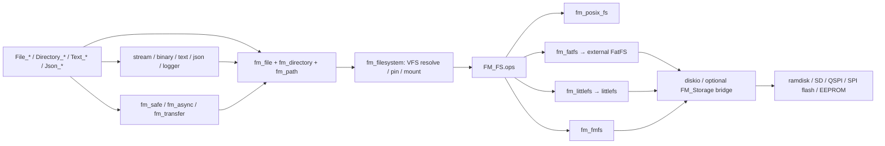

# گراف فایل، VFS و ذخیره‌سازی

[بازگشت به ورودی](README.md) · [فهرست ماژول‌ها](MODULE_INDEX.md) · [حافظه و پورت](PORTABILITY_MEMORY.md) · [تست‌ها](TESTING.md)

مسیرهای جدول زیر نسبت به `Clain_FileManager/FileManager_lib/` هستند. این گراف **روابط اصلی و مشروط** را خلاصه می‌کند؛ هر فلش را هنگام تغییر با کد و configuration بررسی کنید.

## ورود سریع بر اساس مسئله

| مسئله | API و مالک | مسیرهای بعدی / آزمون نقطه‌ای |
|---|---|---|
| init، lifecycle و ABI | `include/file_manager.h`, `src/fm_core.c` | `FileManager_InitChecked`، تنظیم `fm_config.h` و تست `test/audit_v5_tests.h` |
| register/mount/unmount | `include/fm_storage.h`, `include/fm_filesystem.h`, `src/fm_storage.c`, `src/fm_filesystem.c` | `FM_VFS_Pin`, `FM_VFS_Unpin`, mount table و backend مربوط؛ `test/main.c` |
| open/read/write/seek/close | `include/fm_file.h`, `src/fm_file.c`, `src/fm_internal.h` | `File_OpenEx`/`File_Open`، handle pool و `FM_FS` ops؛ `test/main.c`, `test/audit_v2_tests.h`, `test/audit_v5_tests.h` |
| نام، normalization، overlap | `include/fm_path.h`, `src/fm_path.c` | `test/audit_v5_tests.h`; `tools/check_path_overlap.py` روی checkout جدیدتر از commit `7866232` |
| پوشه، traversal، copy/move | `include/fm_directory.h`, `src/fm_directory.c`, `src/fm_file.c` | resolve، depth، callback و cleanup؛ `test/audit_v2_tests.h`, `test/audit_v5_tests.h` |
| copy/verify و نرخ انتقال | `include/fm_transfer.h`, `src/fm_transfer.c`, `src/fm_file.c` | API فایل/stream یا storage مقصد؛ cache hooks در configuration، تست‌های `test/main.c` |
| فایل موقت، transaction، متن | `include/fm_safe.h`, `src/fm_safe.c`, `src/fm_text.c`, `src/fm_file.c` | `.fm_tmp`/backup؛ rename و delete backend؛ برای محدودیت atomicity به گزارش فایل مراجعه کنید. |
| انواع داده و تبدیل | `include/fm_binary.h`, `fm_text.h`, `fm_json.h`, `fm_stream.h` و `src/` هم‌نام | مالک بافر/اندازه، خطاهای parser و file API؛ تست‌های `test/main.c` |
| logger، جست‌وجو، async | `include/fm_logger.h`, `fm_explorer.h`, `fm_async.h`; `src/` هم‌نام | lifecycle، callback/cancel و فایل‌های واسط؛ `test/audit_v5_tests.h` و `test/main.c` |
| گزارش خطا، لاگ، CRC | `include/fm_types.h`, `fm_log.h`, `fm_debug.h`, `fm_crc.h`; `src/fm_log.c`, `fm_crc.c`, `fm_core.c` | تفاوت last-error سراسری/نخی و تنظیم debug؛ `test/debug_log_tests.h` |
| USB به‌عنوان block device | `include/fm_usb_msc.h`, `src/fm_usb_msc.c`, `top_api/usb_msc.h`, `top_api/usb_msc_simple.h` | مالکیت مشترک storage و cache با SD؛ `test/usb_msc_host_test.c` و board glue |

## قرارداد فایل‌سیستم و دستگاه

- `FM_FS` و جدول `FM_FSOps`: `include/fm_filesystem.h`. `FM_Storage` و جدول درایور: `include/fm_storage.h`. فایل‌سیستم و storage یکی نیستند: اولی عملیات فایل/پوشه ارائه می‌کند، دومی عملیات بلوک/بایت دستگاه را مدل می‌کند.
- `backends/fm_fatfs.c`: wrapper نسخه‌های FatFS خارجی؛ `FM_FATFS_PROVIDE_DISKIO` تعیین می‌کند bridge خود کتابخانه یا diskio پروژه مسئول است. تنظیمات پروژه در `FATFS/Target/ffconf.h` و `FATFS/App/`؛ برای جزئیات به `include/fm_fatfs.h` مراجعه کنید.
- `backends/fm_littlefs.c` و `third_party/littlefs/`: adapter و پیاده‌سازی vendor؛ قبل از تغییر semantics writer/readers و sync را بررسی کنید.
- `src/fm_fmfs.c`: filesystem داخلی روی storage، شامل metadata/journal؛ `FM_FMFS_POWER_SAFE` و تست‌های cut/recovery را از `test/` و `tools/check_matrix.sh` بررسی کنید.
- `backends/fm_posix_fs.c`: backend میزبان؛ `backends/fm_ramdisk.c`: storage حافظه‌ای. نتیجهٔ host جایگزین timing و رفتار کارت واقعی نیست.
- ابزارهای دستگاه: `src/fm_sd_hal.c`, `fm_qspi.c`, `fm_spiflash.c`, `fm_eeprom.c`, `fm_eeprom_chips.c`, `fm_device.c`; HAL نمونه و تکیه‌گاه‌ها در `top_api/` و `board/` هستند.

## روابط حساس و قراردادهای تأییدنشده

1. `File_*` → pin/resolve mount → `FM_FS.ops`؛ دورهٔ عمر handle، mount و قفل‌ها را هم‌زمان بررسی کنید، نه فقط یک تابع.
2. `File_Copy`/`File_Move`/تعدادی editor → فایل موقت و rename/delete؛ source/destination alias، collision نام، short write و rollback جداگانه مهم‌اند.
3. FatFS برای rename-over از چند عملیات استفاده می‌کند. **این نقشه آن را crash-atomic فرض نمی‌کند.** نام‌های موقت اشغال‌شده نباید فقط بر اساس نام پاک شوند؛ فایل‌های دیگر نظیر `.fm_tmp`/`.bak` نیز نیازمند بررسی ownership و قراردادند.
4. `FM_USE_THREADS`, انتخاب sync port، cache، تعداد handleها و mountها بر قرارداد و نحوهٔ تست اثر می‌گذارند. مقدارهای مستند default در `fm_config.h` قابل override هستند.
5. `tools/restore_fatfs_lock.py` کمک پس از regeneration است؛ وجود آن به معنای نصب hook خودکار CubeMX نیست.

## شواهد و مسیرهای بررسی

- گزارش کار مستقل: [`audit_reports/FILE_PHASE1_INTERNAL.md`](../audit_reports/FILE_PHASE1_INTERNAL.md). یافته‌های گزارش جدید: [`audit_reports/FILE_V51_REVIEW.md`](../audit_reports/FILE_V51_REVIEW.md) و [`ReportV51.txt`](../ReportV51.txt)؛ وضعیت جدیدتر و ریسک‌ها: [`FILE_V51_REMEDIATION_3.md`](../audit_reports/FILE_V51_REMEDIATION_3.md). توجه: ساختارهای عمومی `FM_FS`, `FM_FSOps`, `FM_Dir`, `FM_Async`, `FM_JsonWriter` تغییر ABI دارند؛ custom adapter باید exclusive-create و انتشار no-replace را صریحاً پشتیبانی کند.
- سه ممیزی پیشنهادی و نسخهٔ هدفشان: [`audit_prompts/file_phase1/README.md`](../audit_prompts/file_phase1/README.md).
- `sh test/build_fatfs_host.sh`: mock چند نسخه با ASan/UBSan؛ `sh tools/check_fatfs_real_rename.sh <source>`: FatFS واقعی خارجی با RAM disk؛ این دو مدل آزمایش متفاوت‌اند.
- `make check`, `make tsan`, `sh tools/check_32bit.sh`, `sh tools/check_matrix.sh`: دامنه و پیش‌نیاز را در [TESTING.md](TESTING.md) ببینید. هیچ‌کدام تضمین کامل خرابی/قطع برق واقعی نیستند.
