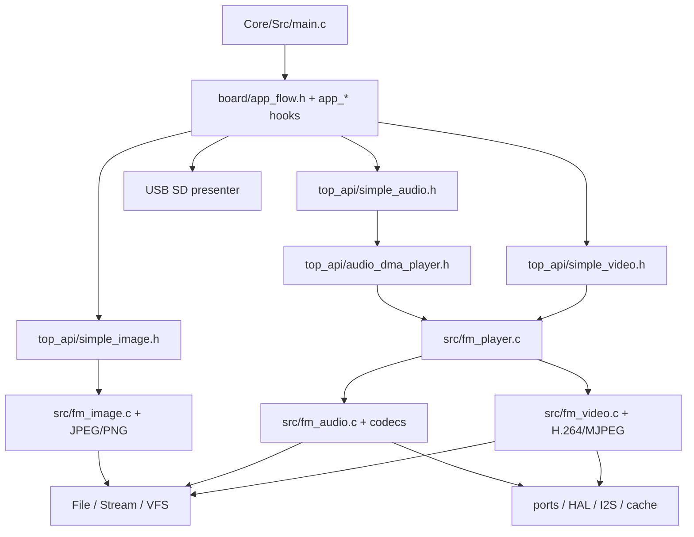

# گراف رسانه، حلقهٔ برنامه و برد

[بازگشت به ورودی](README.md) · [فایل و storage](FILE_STORAGE.md) · [port و حافظه](PORTABILITY_MEMORY.md) · [تست‌ها](TESTING.md)

مسیرهای بدون پیشوند نسبت به `Clain_FileManager/FileManager_lib/` هستند. این صفحه راهنمای پیدا کردن کد است، نه تضمین تمام formatها یا جدول دقیق فراخوان.

## پیدا کردن مالک

| مسئله | نقطهٔ شروع | ارتباط بعدی / تست |
|---|---|---|
| تشخیص نوع | `include/fm_media.h`, `src/fm_media.c` | `Media_DetectBuffer`, `File_DetectType`، ID3/extension و `test/audit_audio_late_tests.h` |
| تصویر و pixel format | `include/fm_image.h`, `src/fm_image.c`, `fm_jpeg.c`, `fm_png.c`, `fm_hw.c` | `picojpeg`, `top_api/hw_jpeg.h`, DMA2D؛ `test/main.c`, `test/hw_jpeg_host_test.c` |
| صوت standalone و seek | `include/fm_audio.h`, `src/fm_audio.c`, `fm_flac.c`, `fm_vorbis.c`, `fm_opus.c` | minimp3/dr_flac/stb/libopus و decoder plugins؛ `test/audit_audio_late_tests.h`, `tools/test_mp3_gapless.py` |
| ذخیره/تبدیل صوت | `include/fm_audio.h`, `src/fm_audio_enc.c`, `top_api/simple_audio.h` | writer، callback و storage؛ `test/audio_save_tests.h`, `tools/audio_record_host_test.c` |
| container و ویدئو | `include/fm_video.h`, `src/fm_video.c`, `fm_h264.c`, `fm_mjpeg.c`, `fm_mediacache.c` | vendored `h264bsd`/`picojpeg`، صوت و stream فایل؛ `test/audit_v3_tests.h`, `test/audit_v4_tests.h` |
| ذخیره/تبدیل ویدئو | `src/fm_video_enc.c`, `include/fm_video.h`, `top_api/simple_video.h` | JPEG/audio writer، callback و زمان‌بندی؛ `test/video_save_tests.h`, `tools/save_examples_host_test.c` |
| playlist و DMA صوت | `include/fm_player.h`, `src/fm_player.c`, `top_api/audio_dma_player.h`, `top_api/simple_audio.h` | DMA refill، callback، seek/stop، `FM_Idle`; تست host هر دو نسخه در `tools/audio_record_host_test.c` |
| slideshow و player ویدئو | `top_api/simple_image.h`, `top_api/simple_video.h` | نمایشگر، I2S mux و player؛ `tools/save_examples_host_test.c`, `test/video_hooks_test.c` |
| زمان ویدئو/صوت در کار طولانی | `top_api/simple_idle_mux.h`, `simple_i2s_mux.h`, `src/fm_core.c`, `src/fm_video.c` | `FM_Idle` و فراخوان‌های ممکن به Poll؛ reentrancy/timing را از graph نتیجه نگیرید. |
| کوپلینگ ذخیرهٔ هنگام پخش | `top_api/simple_audio.h`, `audio_dma_player.h`, `board/app_save_hooks.h` | مسیرهای recorder متفاوت‌اند؛ SAV3-04 را در گزارش پایین ببینید. |
| بستهٔ دادهٔ رسانه | `top_api/media_data_io.h` | تماس با APIهای image/audio/video و بافر caller |
| حافظهٔ cache و frameهای media | `include/fm_mediacache.h`, `src/fm_mediacache.c` | تعامل با allocation و طول عمر frame؛ feature flags |

## برد نمونه و مسیر برنامه

- `Clain_FileManager/Core/Src/main.c` ابتدا MPU/cache/HAL و peripheralها را راه می‌اندازد، سپس `App_LibraryBegin` و demoها و در حلقهٔ اصلی Pollها را فراخوانی می‌کند. ترتیب واقعی را در همان فایل بررسی کنید.
- `board/app_flow.h` گام‌های setup؛ `board/app_display.h` نمایش؛ `board/app_audio_hooks.h`، `app_video_hooks.h` و `app_save_hooks.h` callback/recorder؛ `board/app_uart_commands.h` و `top_api/code_cmd.h` مسیر command را دارند. `board/README.md` جزئیات محدوده‌های CubeMX را توضیح می‌دهد.
- `top_api/` راهنمای header-only نمونه است؛ نسخه‌های `examples/` نیز در repository وجود دارند و بعضی تست‌ها هر دو را می‌سنجند. پیش از تغییر بررسی کنید آیا دو نسخه هنوز متناظرند؛ یکسان بودن کامل آن‌ها تضمین‌شده نیست.
- `top_api/simple_i2s_mux.h` مالک مشترک I2S نمونه است، `simple_idle_mux.h` hooks idle را ترکیب می‌کند؛ `top_api/spi_tft_dma.h`, `dma2d_ycbcr.h`, `hw_jpeg*.h`, `ltdc_present.h` وابسته به نمایش و HAL هستند.
- کد `Core/`, `FATFS/`, `USB_DEVICE/` نمونهٔ STM32 و تولید CubeMX است. `USER CODE`، تنظیمات CubeMX و نام sectionها در regeneration و انتقال باید بررسی شوند؛ `.ioc` و linker script در checkout فعلی موجود نیستند.

## محدودیت‌های فعلی که نباید پنهان شوند

- `audit_reports/FATFS_RECORDER_FOLLOWUP.md`: مسیر `SimpleAudio` برای ضبطِ پخش می‌تواند نوشتن هم‌زمان را در refill انجام دهد؛ آزمایش تزریق deadline میزبان وقوع flag را نشان داده، نه latency کارت واقعی. این با recorderهای pumpشدهٔ board یک مسیر واحد فرض نشود.
- `audit_reports/MP3_GAPLESS_FOLLOWUP.md`: trim برای metadata پشتیبانی‌شده، seek دقیق خطی و fallback برای موارد دیگر؛ همهٔ encoderها و زمان هدف اثبات نشده‌اند.
- `audit_reports/CLOSED_LOOP_HOST.md`, `AUDIO_FOLLOWUP.md`, `ID3_CHAIN_FOLLOWUP.md` منابع تاریخی و محدودیت‌های تست هستند. تاریخ و superseding note را بخوانید، نه صرفاً یک PASS را.
