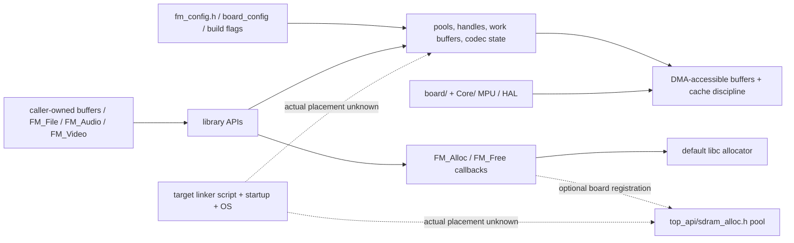

# حافظهٔ اجرایی و انتقال به پلتفرم دیگر

[بازگشت به ورودی](README.md) · [فایل و storage](FILE_STORAGE.md) · [رسانه و برد](MEDIA_BOARD.md) · [تست‌ها](TESTING.md)

این صفحه علاوه بر «حافظهٔ دانشی پروژه»، سرنخ‌های **حافظهٔ اجرایی** را نشان می‌دهد. آدرس‌ها و اندازه‌های زیر از کد/پیش‌فرض نمونه برداشت شده‌اند؛ **linker map، اندازهٔ نهایی RAM/Flash، هم‌پوشانی sectionها و رفتار واقعی برد اندازه‌گیری نشده‌اند**. برای انتقال به Zynq یا هر مقصد دیگر معماری پردازنده، OS، memory map و cache را از مستندات همان محصول تعیین کنید؛ این مخزن خودبه‌خود برای آن مقصد آماده فرض نمی‌شود.

## نمای ownership

## نقطه‌های واقعی برای بررسی

| موضوع | کد مرجع | آنچه فعلاً می‌دانیم / کار لازم |
|---|---|---|
| داده‌های caller و ABI | `lib/include/file_manager.h`, `fm_types.h`, `fm_file.h`, `fm_audio.h`, `fm_video.h` | بعضی handleها و bufferها caller-owned هستند؛ ownership هر API را در header خودش چک کنید. `FileManager_InitChecked` برخی اختلاف اندازه‌ها را تشخیص می‌دهد، ولی تضمین کل ABI نیست. |
| allocator | `lib/include/fm_alloc.h`, `lib/src/fm_alloc.c` | default از libc و امکان `FM_Allocator_Set`; قرارداد آزادسازی، failure و lifetime را در کد ببینید. |
| allocator نمونهٔ SDRAM | `lib/top_api/sdram_alloc.h`, `lib/board/app_flow.h` | نمونه pool در section `.sdram_buffers`؛ `SDRAM_ALLOC_BYTES` به‌طور پیش‌فرض ۸ MiB است و override می‌شود. اینکه linker آن را کجا قرار دهد در فایل linker واقعی تعیین می‌شود. |
| حافظهٔ DMA نمونه | `lib/top_api/simple_i2s_mux.h`, `simple_audio.h`, `include/fm_sd_bounce.h`, `top_api/spi_tft_dma.h` | نام section `.dma_buffer` و alignment در کد وجود دارد؛ ring صوت `SIMPLE_I2S_RING_SAMPLES` پیش‌فرض 65534 نمونهٔ `int16_t` است. محاسبهٔ ظرفیت با ویژگی‌های build انجام شود، نه بر اساس این عدد به‌تنهایی. |
| MPU نمونه | `Core/Src/main.c:MPU_Config`, `lib/board/app_flow.h:App_MpuUserRegions` | کد نمونه برای regionهای SDRAM، QSPI و D2 SRAM تنظیم دارد. ترتیب و ویژگی cache را از متن کد بخوانید؛ آدرس‌ها تعمیم‌پذیر نیستند. |
| cache و DMA | `lib/include/fm_cache.h`, `fm_sd_bounce.h`, `top_api/cache.h`, `sd_diskio_cache_patch.h` | clean/invalidate، alignment و دسترسی DMA بر اساس پلتفرم تعیین می‌شوند؛ Host stub صحت coherency فیزیکی را ثابت نمی‌کند. |
| work buffer و pool | `lib/include/fm_config.h`, `fm_buffers_level.h`, `lib/src/fm_internal.h` | مقادیر وابسته به `FM_BUFFERS`, `FM_MAX_*`, feature switches و compiler/ABI هستند؛ برای ظرفیت واقعی `sizeof`, `size`, linker map و stack analysisِ build مقصد لازم‌اند. |
| audio/video codec allocations | `lib/src/fm_audio.c`, `fm_video.c`, `fm_h264.c`, `fm_opus.c`, `fm_mediacache.c`, `third_party/` | حافظهٔ stack/static/heap و lifetime را با فرمت و feature فعال بررسی کنید؛ هیچ سقف سراسری از این سند استنتاج نشود. |
| sync/thread | `lib/include/fm_sync.h`, `fm_port.h`, `lib/ports/` | pthread/freertos/cmsis_rtos2 نمونه‌اند؛ ISR، memory ordering، lock و reentrancy در مقصد باید جدا تأیید شوند. |
| filesystem/storage | `lib/include/fm_filesystem.h`, `fm_storage.h`, `lib/backends/`, `lib/src/fm_fmfs.c` | block geometry، sync/flush، cache، endian، filesystem و ownership از قراردادهای واقعی درایور مقصد است. |

## آدرس‌های پیکربندی‌شدهٔ نمونهٔ STM32

در کد فعلی `Core/Src/main.c`، MPU نمونه برای SDRAM در `0xC0000000` با اندازهٔ 32 MiB و QSPI در `0x90000000` با اندازهٔ 8 MiB تنظیم شده است. `board/app_flow.h` یک region دیگر در `0x30000000` با اندازهٔ 256 KiB و ویژگی non-cacheable برای D2 SRAM تنظیم می‌کند. این‌ها **تنظیمات MPU منبع** هستند، نه اثبات آدرس یا ظرفیت واقعی هر symbol. کد و `board/README.md` را برای ترتیب و جزئیات ببینید.

در checkout فعلی linker script و فایل `.ioc` پیدا نشده‌اند؛ بنابراین از روی این مخزن نمی‌توان جای قطعی `.dma_buffer`, `.sdram_buffers`, heap، stack و تمام sectionها را تأیید کرد. مقدار حافظهٔ مصرفی runtime نیز اندازه‌گیری نشده است.

## چک‌لیست انتقال — طراحی، نه ادعای انجام‌شدن

1. نوع هدف و toolchain، واحد و عرض نوع‌ها، endianness، ABI، مدل OS/IRQ و قرارداد خطا را صریح کنید. تنظیم‌ها را یکسان برای application و library بسازید.
2. `FM_Storage`/`FM_FS` و geometry مقصد، alignment، partial I/O، atomic rename و معنای `sync` را تعریف و با oracle مناسب آزمایش کنید.
3. allocator و poolها، حافظهٔ DMA-accessible، cache-line size، clean/invalidate، memory barriers و reentrancy/lockهای مقصد را با نقشهٔ linker و مدارک platform تعیین کنید.
4. HAL/clock/interrupt، display/audio/USB glue و `top_api` نمونه را از هستهٔ فایل جدا کنید؛ عدم نیاز مقصد به این قسمت‌ها را در build config نشان دهید.
5. برای build واقعی، map file، `size`/`nm`, stack usage، heap worst-case، fragmentation و شرایط شکست allocation را ثبت کنید. در صورت نبود linker/firmware واقعی، نتیجه را «نامعلوم» بنویسید.
6. host tests، 32/64-bit، fault injection، concurrency و مدل backend را اجرا کنید؛ تست فیزیکی فقط اگر کاربر بعداً مجاز بداند. به [TESTING.md](TESTING.md) مراجعه کنید.
