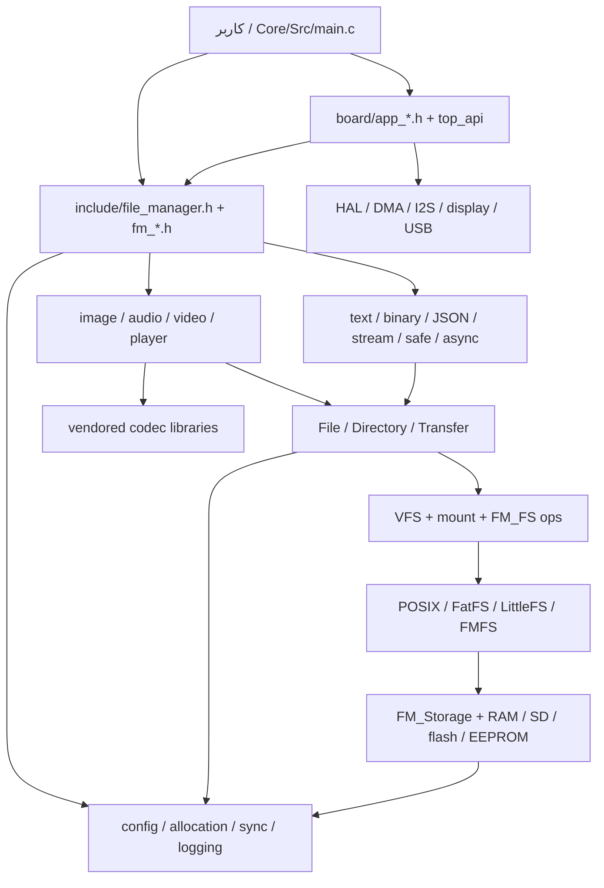

# حافظهٔ پروژه و گراف راهبری ایجنت

این نقشه برای پیدا کردن سریع **محل مسئولیت، ارتباط اجزا، مسیر داده و تست‌های مرتبط** است؛ نه جایگزین خواندن کدِ همان بخش و نه گواه صحت آن. نقطهٔ شروع ایجنت‌ها در [`AGENTS.md`](../AGENTS.md) است. مبنای تدوین: tree پروژه در زمان ساخت این نقشه، پس از `745f81c`. پیکربندی فعال، نسخهٔ ابزار و تغییرات بعدی ممکن است مسیر واقعی را عوض کنند.

## استفادهٔ سریع

| نوع کار | شروع کم‌هزینه | سپس |
|---|---|---|
| فایل، مسیر، mount، ذخیره‌سازی یا خطا | [گراف فایل و storage](FILE_STORAGE.md) | header عمومی، implementation و تست ذکرشده |
| تصویر، صوت، ویدئو، پخش، UI یا DMA | [گراف رسانه و برد](MEDIA_BOARD.md) | تابع و callback مربوط؛ سپس backend فایل |
| جابه‌جایی به پلتفرم/حافظهٔ دیگر | [نقشهٔ portability و حافظه](PORTABILITY_MEMORY.md) | قرارداد port، allocator، linker/MPU و storage مقصد |
| انتخاب تست و ردیابی یافته‌های قبلی | [تست‌ها و شواهد](TESTING.md) | تست هدفمند در workspace جدا |
| نام تابع یا فایل را می‌دانید | `python3 project_memory/graph.py query File_OpenEx` | فایل و خط پیشنهادی را در سورس فعلی بررسی کنید |
| فهرست سریع ماژول‌های `src/` | [فهرست تولیدشده](MODULE_INDEX.md) | headerهای هم‌نام و ارجاعات نزدیک |

مسیرهای این مجموعه نسبت به **ریشهٔ مخزن** یا به‌صورت لینک نسبی نوشته شده‌اند. `Clain_FileManager/FileManager_lib/` در نمودارها با `lib/` خلاصه شده است. پرس‌وجو فقط match متنی نام فایل، تعریف احتمالی تابع و include را نشان می‌دهد؛ فراخوان‌ها، macroها و declarationها را الزاماً پیدا نمی‌کند. اگر چیزی پیدا نشد با `rg` در محدودهٔ کوچک‌تر جست‌وجو کنید.

## گراف لایه‌ها

فلش `A → B` در این نمودار یعنی **A معمولاً از قرارداد یا خدمات B استفاده می‌کند**؛ نه لزوماً یک فراخوان مستقیم، نه تضمین فعال بودن هر مسیر در تمام buildها.



| گره | مالک اصلی | نکتهٔ مرزی |
|---|---|---|
| API عمومی | [`file_manager.h`](../Clain_FileManager/FileManager_lib/include/file_manager.h) و `include/fm_*.h` | exportها و feature guards را در build واقعی بخوانید. |
| هستهٔ مشترک | `src/fm_core.c`, `fm_alloc.c`, `fm_storage.c`, `fm_filesystem.c`, `fm_internal.h` | lifecycle، allocator، lock و mount روی اکثر لایه‌ها اثر دارند. |
| فایل و ابزار | `fm_file.c`, `fm_directory.c`, `fm_path.c`, `fm_transfer.c`, `fm_safe.c`, `fm_text.c`, `fm_json.c`, `fm_binary.c`, `fm_stream.c`, `fm_async.c`, `fm_logger.c`, `fm_explorer.c` | عملیات متن و جایگزینی می‌توانند هم‌زمان از چند فایل/handle استفاده کنند. |
| فایل‌سیستم | `backends/fm_fatfs.c`, `fm_littlefs.c`, `fm_posix_fs.c`; `src/fm_fmfs.c` | قرارداد `FM_FS.ops`؛ ضمانت atomicity و persistence بین backendها یکسان نیست. |
| رسانه و پخش | `src/fm_image.c`, `fm_audio.c`, `fm_video.c`, `fm_player.c` و codec/encoderهای هم‌گروه | از API فایل استفاده می‌کنند؛ ذخیرهٔ رسانه با `fm_audio_enc.c`/`fm_video_enc.c` است. |
| برد و نمایش | `Core/`, `FATFS/`, `USB_DEVICE/`, `board/`, `top_api/`, `sdram/`, `printf_redirect/` | glue و کد CubeMX نمونهٔ STM32 هستند؛ قرارداد عمومی پلتفرم نیستند. |
| پورت‌ها | `include/fm_port.h`, `fm_sync.h`, `ports/{pthread,freertos,cmsis_rtos2}/` | هم‌زمانی، cache، زمان و HAL باید برای مقصد جدید جدا بررسی شوند. |
| third-party | `lib/third_party/` | جزئیات داخلی در inventory به عمد باز نشده‌اند؛ نام خانواده‌ها در فهرست تولیدی است. |

## نگهداری و تازگی

```sh
python3 project_memory/graph.py check          # فقط بررسی؛ کد خروجی ۱ یعنی stale
python3 project_memory/graph.py query File_OpenEx
python3 project_memory/graph.py update         # بازتولید inventory و module index
python3 project_memory/test_graph.py           # تست خود ابزار، بدون تغییر پروژه
python3 project_memory/graph.py check
```

پس از هر تغییر در فایل‌های first-party انتخاب‌شده، `check` هشدار می‌دهد؛ **خودبه‌خود چیزی را به‌روز نمی‌کند**. ابتدا نمودارها و روابط دستی مرتبط را مرور و اصلاح کنید، سپس `update` بزنید و تغییرات گراف را همراه تغییر کد نگه دارید. فایل‌های تولیدی `inventory.json` و `MODULE_INDEX.md` را دستی ویرایش نکنید. اضافه‌شدن/حذف/تغییر فایل، هش محتوا و فهرست پوشه‌های اصلی vendor بررسی می‌شوند؛ محتوای داخلی vendor، fixtures، stubها، فایل‌های تولید build و صحت معنایی متن دستی به‌طور کامل بررسی نمی‌شوند. عبارت `query` از snapshot تولیدی استفاده می‌کند؛ در صورت stale بودن نتیجه ممکن است قدیمی باشد.

`inventory.json` شامل فایل‌های انتخابی، SHA-256، اندازه، includeهای lexical و **تعریف‌های احتمالی** است. includeها ممکن است وابسته به `#if`، خارجی، unresolved یا چندمعنایی باشند؛ candidate به معنی فعال بودن dependency نیست. استخراج تابع regex است، نه C parser؛ اشاره‌گر تابع، macro، declaration و call graph را کامل استخراج نمی‌کند. برای layout حافظه به linker map واقعی و configuration build نیاز دارید؛ نمودار حافظهٔ فعلی چنین چیزی را ادعا نمی‌کند.

## قرارداد نگهداری برای ایجنت بعدی

1. `git status --short` و `graph.py check`؛ تغییرات کاربر را حفظ کنید.
2. اول فقط سند task و nodeهای آن، سپس header و implementation و تست دقیق را بخوانید؛ هنگام ابهام مسیر را در سورس دنبال کنید.
3. اگر رفتار/مرز مالکیت/feature flag/test عوض شد، صفحهٔ دستی مربوط و روابط آن را هم اصلاح کنید؛ فقط refresh خودکار کافی نیست.
4. تست گراف، لینک‌های محلی و تست‌های متناسب با خود تغییر را اجرا کنید؛ برای هر skip دلیل ثبت کنید.
5. `graph.py update` و `check` را اجرا و فایل‌های تغییرکردهٔ گراف را در همان patch بیاورید. ادعای به‌روزماندن دائمی بدون اجرای این روند نکنید.
